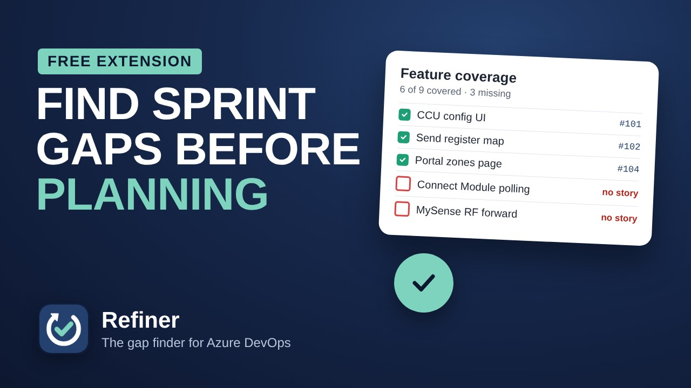
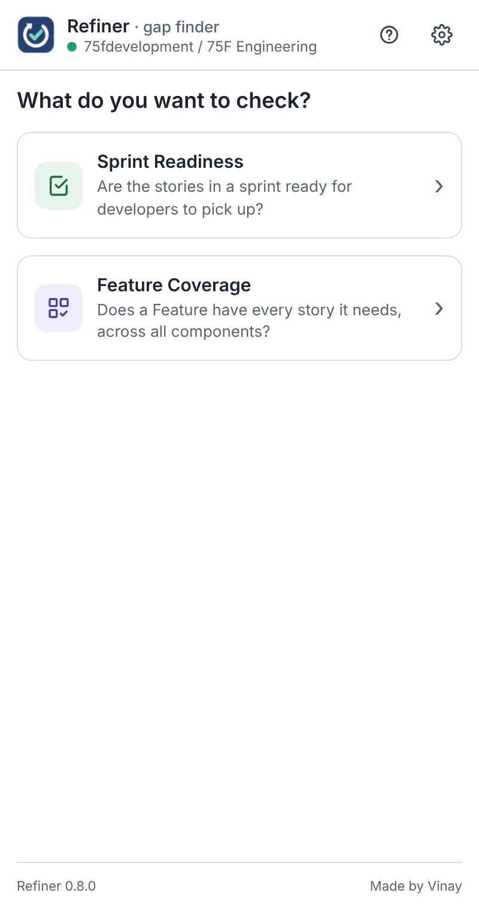
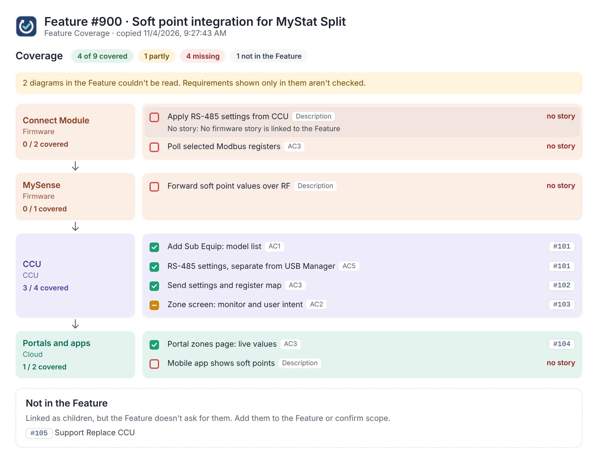

# Refiner

**The gap finder for Azure DevOps.**

Check your Azure DevOps work before sprint planning, with the AI assistant you already use. Refiner reads your stories and Features, prepares a review for ChatGPT, Gemini, Copilot, Claude or any assistant you choose, and turns the answer into a clear, clickable result.

**Walkthrough:** after downloading, open [`START HERE.html`](START%20HERE.html) in your browser for a step-by-step guide with play and pause. The same guide opens from the **?** button inside the extension.

## Why

Sprint planning goes wrong when a story turns out to be missing details, or when nobody noticed that a Feature has no firmware story at all. Checking every story and every Feature by hand takes hours. Refiner gathers everything from Azure DevOps in one click, asks your AI the right questions, and shows you what to fix first.

## Features

- **Sprint Readiness:** for an area and sprint, checks whether each story has clear intent, testable acceptance criteria, the technical details a developer needs, and finished dependencies. Gives each story a verdict and one thing to fix, grouped by owner.
- **Feature Coverage:** works out what a Feature needs from its acceptance criteria, description and discussion, component by component, then ticks off which child stories deliver each piece. Missing work shows as an empty red box.
- **Works with any AI assistant.** Nothing to set up and no API keys: copy the prompt, paste it into your assistant, paste the answer back.
- **Team context from your wiki.** A short page per area (components, how data flows, team rules) is added to every review, so the AI understands your product.
- **Learns over time.** The AI suggests rules; approve one and it's added to your team's wiki page for future reviews.
- **Stays open in the side panel** while you switch between Azure DevOps and your AI.
- Uses your normal Azure DevOps sign-in. No tokens, no servers.

  
  

## Install

Works in Chromium browsers with a side panel: Chrome 114 or later, and Edge.

1. Download this repository (**Code → Download ZIP**, or the zip from the latest [Release](../../releases)) and extract it somewhere permanent.
2. Open your browser's extensions page:

   | Browser | Address |
   |---|---|
   | Chrome | `chrome://extensions` |
   | Edge | `edge://extensions` |

3. Turn on **Developer mode** (top-right; in Edge it's in the left sidebar).
4. Click **Load unpacked** and choose the `sprint-assistant` folder, the one containing `manifest.json`.
5. Pin Refiner from the puzzle-piece menu (in Edge, click the eye icon).

For a step-by-step guide with pictures, open [`START HERE.html`](START%20HERE.html) in your browser after downloading.

## Use

1. Open your project in Azure DevOps in any tab.
2. Click the Refiner icon. The side panel opens; the first time, choose your AI assistant.
3. Choose **Sprint Readiness** (pick an area and sprint) or **Feature Coverage** (open a Feature, or type its ID).
4. **Copy prompt**, open your assistant, paste and send in a new chat.
5. Copy the AI's whole answer, paste it back into the panel and click **Show result**. **Open full result** shows every item with links to Azure DevOps.

## Team context page

In your project wiki, create a page called **Sprint Assistant** with one sub-page per area or team, for example `Firmware` or `Squad 2`. The panel matches the sub-page to the area you check (`75F Firmware` finds `Firmware`) and can create a page for you from a starter template. Keep it short: components, how data flows, what a feature usually needs, a glossary and team rules.

## Update

Replace the contents of your `sprint-assistant` folder with the new version, then click the reload button on Refiner's card on the extensions page.

## Privacy and permissions

Refiner asks for `sidePanel`, `scripting` and `storage`, and only for `dev.azure.com` and `*.visualstudio.com`. It reads work items and wiki pages through your open Azure DevOps tab, using your own sign-in. It makes no requests to any other server: the prompt reaches your AI assistant only when you paste it there yourself. It writes to Azure DevOps only when you create a team context page or approve a learning, and asks you to confirm first. Settings and recent checks are stored in your browser.

Please follow your organisation's rules on what work item content may be shared with AI assistants.

## Limitations

Refiner uses the Azure DevOps REST APIs and expects the Agile process names (`User Story`, `Feature`, `Closed`, `Removed`). Other process templates may need the names at the top of `sprint-assistant/panel.js` changed. Images inside work items can't be read by the AI; the result says how many were skipped. If something stops working, please [open an issue](../../issues).

## For maintainers

| What | Where |
|---|---|
| Review rules and output formats | `sprint-assistant/prompt.js` |
| Work item types and states | top of `sprint-assistant/panel.js` |
| Length limits | `LIMITS` in `sprint-assistant/format.js` |
| Walkthrough slides | `sprint-assistant/guide/guide.js` |

## Disclaimer

Refiner is an independent project and is not affiliated with or endorsed by Microsoft. Azure DevOps is a trademark of Microsoft. ChatGPT, Gemini, Copilot and Claude are trademarks of their respective owners.

Made by Vinay. Released under the [MIT License](LICENSE).
